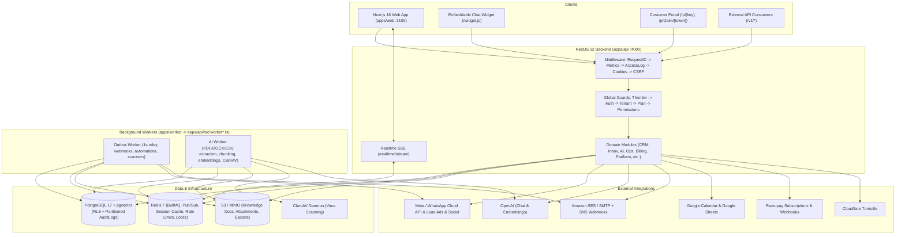

# System & Application Architecture

*Last analyzed: 2026-11-27*

## High-Level System Architecture

---

## Frontend Architecture (`apps/web`)

- **Framework**: Next.js 16 App Router (`apps/web/app/`), React 19, TypeScript 6, Tailwind CSS v4.
- **Route Groups**:
  - `(auth)/`: Public authentication, registration, SSO callback, password reset, email verification, and invitation acceptance (`AuthLayout`).
  - `(app)/`: Authenticated tenant workspace wrapped by `apps/web/app/(app)/layout.tsx` (`useMe()`, redirects `401` to `/login?next=...`, renders `AppShell` with sidebar, workspace switcher, command palette `⌘K`, notification bell, help tours, and billing/verification/deletion/support banners).
  - `platform/`: Vendor staff console wrapped by `apps/web/app/platform/layout.tsx` (`PlatformShell`), strictly isolated from tenant cookies via `platformApi` (`apps/web/lib/platform.ts`).
  - `p/[key]` & `p/claim/[token]`: Public customer portal (OTP-authenticated via `lp_portal` cookie) and Slot Rescue 1-tap claim page.
  - `invoice/[id]` & `data-deletion`: Printable GST invoice and Meta data-deletion status page.
  - `design/*` & `dev-error`: Static UI design previews and dev-only error boundary trigger.
- **State & Data Fetching**:
  - `@tanstack/react-query` v5 for server state, polling (e.g., knowledge doc status, automation run history), and mutations.
  - Hand-written typed API helpers in `apps/web/lib/*.ts` (`api.ts`, `crm.ts`, `inbox.ts`, `ops.ts`, `billing.ts`, `campaigns.ts`, `reports.ts`, `ai.ts`, `platform.ts`) alongside Orval-generated hooks in `apps/web/lib/api-generated/` (`pnpm codegen:api`).
  - `react-hook-form` + `@hookform/resolvers/zod` using schemas from `@leadpilot/validation` and `handleApiError` (`apps/web/lib/forms.ts`).
  - `AppShell` subscribes to `GET /realtime/stream` (SSE) to invalidate React Query caches and trigger in-app/desktop/sound alerts.

---

## Backend Architecture (`apps/api` & `apps/worker`)

- **Framework**: NestJS 12 (`"type": "module"`, ESM imports with `.js` extensions), Express adapter (`apps/api/src/bootstrap.ts`), Helmet CSP, dynamic CORS (permissive for `/widget/*` and `/widget.js`, strict `WEB_ORIGIN` with credentials for app routes), Swagger UI at `/docs` (non-prod or `API_DOCS_ENABLED=true`).
- **Request Lifecycle (`apps/api/src/app.module.ts`)**:
  1. **Middleware** (`*path`): `requestIdMiddleware` → `httpMetricsMiddleware` → `accessLogMiddleware` → `cookieParser` → `csrfOriginMiddleware([WEB_ORIGIN])`.
  2. **Global Guards** (in execution order):
     1. `ThrottlerGuard` — Redis-backed rate limiting (`RedisThrottlerStorage`) outside `NODE_ENV=test`.
     2. `AuthGuard` — Extracts Bearer token or `access` cookie; verifies JWT or support-access token; checks Redis `SessionCacheService` / DB `Session`. Bypassed only for `@Public()` (still parses optional auth).
     3. `TenantGuard` — Resolves `Membership` via `db.tenantTx(...)` using `auth.activeTenantId` (never trusts client-supplied tenant IDs). Enforces active membership, active tenant, and workspace `requireMfa` policy. Resolves `resolveEffectivePermissions(rolePermissions, overrides)`. Bypassed for `@Public()` or `@NoTenant()`.
     4. `PlanGuard` — Checks `EntitlementsService`: blocks writes (`403`) if `pendingDeletionAt` is set, blocks writes (`402`) if subscription is `EXPIRED`/restricted, and enforces `@RequireFeature(...)`. Bypassed for `@BillingExempt()`.
     5. `PermissionsGuard` — Enforces `@RequirePermissions(...keys)`.
  3. **Validation**: `new ZodPipe(schema)` validates `@Body()` / `@Query()` using `@leadpilot/validation` schemas and throws `400` with field-level `details`.
  4. **Global Exception Filter**: `AllExceptionsFilter` normalizes error responses and attaches `requestId`.

### Multi-Tenant Isolation & Security
- **PostgreSQL Row-Level Security (RLS)**: Every tenant-scoped query MUST use `withTenant(prisma, { tenantId, userId }, async (tx) => ...)` (`packages/database/src/index.ts`), which validates UUIDs and sets transaction-local `app.tenant_id` and `app.user_id`.
- **Public Lookups**: Webhooks and public guest links use `SECURITY DEFINER` SQL functions (`find_portal_email_by_key`, `find_slot_rescue_by_token`, etc.) via `db.userTx(null, ...)` before switching to `db.tenantTx(...)`.
- **Envelope Encryption (`SecretBox`)**: `apps/api/src/crypto/secret-box.ts` encrypts provider credentials, MFA secrets, and webhook signing secrets with per-record data keys wrapped by `LOCAL_MASTER_KEY` or AWS KMS (`KEY_PROVIDER=kms`).

---

## Background Workers (`apps/api/src/ops/jobs.service.ts`)

Workers run when `WORKERS_ENABLED=true` (`apps/worker` scripts delegate to `apps/api/src/worker*.ts`):
- **Worker Tiers**: `WORKER_TIER=all` (`worker.ts`), `outbox` (`worker-outbox.ts`), or `ai` (`worker-ai.ts`).
- **BullMQ Queues**:
  - `automation-runs` — Executes graph-based `AutomationRun`s with exponential backoff.
  - `maintenance` — Repeatable 1-minute job running `ScannersService` (appointment reminders, inactivity, SLA breaches, orphaned runs, scheduled campaigns, worker heartbeat, health snapshots, alert evaluation).
  - `webhook-deliveries` — Dispatches signed outbound HTTP webhooks (`WebhookDispatcher`).
  - `ai-knowledge-docs` — Extracts text (PDF/DOCX/TXT/CSV), runs ClamAV scan, sanitizes, chunks, and generates OpenAI embeddings (`KnowledgeService`).
  - `broadcast-campaigns` — Dispatches WhatsApp broadcast template batches (`CampaignsService`).
  - `lead-imports` — Processes large CSV lead imports asynchronously (`LeadImportService`).
- **Outbox Relay**: Polls `outbox_events` every 1 second to enqueue automation runs and webhook deliveries reliably.
