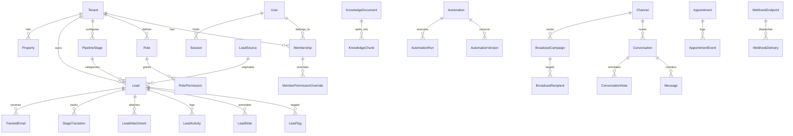

# Database Schema & Data Model

*Last analyzed: 2026-11-27*
*Source of truth: [schema.prisma](file:///Users/vikasrana/Documents/GitHub/ai-leadpilot/packages/database/prisma/schema.prisma)*

## Database Engine & Conventions

- **Engine**: PostgreSQL 17 with `pgvector` (`vector(1536)` for knowledge embeddings) and `citext` (case-insensitive emails).
- **IDs & Timestamps**: UUID primary keys (`gen_random_uuid()` / app-side UUIDv7) and `Timestamptz(3)` UTC timestamps.
- **Row-Level Security (RLS)**: Tenant-scoped tables include `tenant_id` and are queried exclusively through `withTenant(prisma, { tenantId, userId }, fn)` (`packages/database/src/index.ts`), which sets transaction-local `app.tenant_id` and `app.user_id`.
- **Soft Deletes**: `packages/database/src/soft-delete.ts` attaches `softDeleteExtension` to Prisma client queries for models with `deletedAt` (`Lead`, `Property`, `KnowledgeDocument`).
- **Money**: Stored in minor units (`BigInt` / `Int`, e.g., paise for INR).

---

## Core Entity-Relationship Overview

---

## Domain Model Inventory (46 Models)

### 1. Tenancy, Auth, RBAC & Audit (12 Models)
| Model | Table | Scope | Purpose |
|---|---|---|---|
| `Tenant` | `tenants` | Global/Tenant | Workspace profile, `industryPackId`, `planKey`, `status` (`ACTIVE`/`SUSPENDED`/`DELETED`), `settings`, `onboardingState` |
| `User` | `users` | Global | User credentials (`citext` email, Argon2 `passwordHash`), `failedLogins`, `lockedUntil`, `emailVerifiedAt` |
| `Permission` | `permissions` | Global | Read-only catalogue of canonical `PermissionKey`s |
| `Role` | `roles` | Tenant | System (`owner`, `manager`, `agent`) and custom roles |
| `RolePermission` | `role_permissions` | Tenant | Join table mapping `Role` → `Permission` |
| `Membership` | `memberships` | Tenant | Links `User` to `Tenant` with `Role` and `MembershipStatus` (`ACTIVE`/`INVITED`/`DEACTIVATED`) |
| `MemberPermissionOverride` | `member_permission_overrides` | Tenant | Per-member `GRANT` or `REVOKE` overrides |
| `Invitation` | `invitations` | Tenant | Hashed 7-day team invite tokens |
| `Session` | `sessions` | Global | Refresh token hashes with `familyId` rotation-reuse detection |
| `EmailVerificationToken` | `email_verification_tokens` | Global | Single-use email verification tokens |
| `PasswordResetToken` | `password_reset_tokens` | Global | Single-use password reset tokens |
| `AuditLog` | `audit_logs` | Tenant/Global | Append-only (`INSERT` + `SELECT` only), monthly-partitioned by `created_at` |

### 2. CRM & Lead Capture (11 Models)
| Model | Table | Purpose |
|---|---|---|
| `PipelineStage` | `pipeline_stages` | Ordered `OPEN`/`WON`/`LOST` stages with `qualifies` and `canCloseWon` rules |
| `LostReason` | `lost_reasons` | Tenant-configurable reasons required when moving a lead to `LOST` |
| `LeadSource` | `lead_sources` | System and custom attribution sources |
| `CustomFieldDefinition` | `custom_field_definitions` | Dynamic per-tenant fields (`text`, `number`, `select`, `date`, `boolean`) |
| `Lead` | `leads` | Core CRM record (`phoneNorm`/`emailNorm` for dedupe, `budgetMinMinor`/`budgetMaxMinor`, `score`, `scoreOverridden`, `mergedIntoId`, `deletedAt`) |
| `Tag` & `LeadTag` | `tags`, `lead_tags` | Color-coded lead labels |
| `LeadAttachment` | `lead_attachments` | Virus-scanned S3 file attachments linked to leads |
| `LeadNote` | `lead_notes` | Internal notes on a lead |
| `LeadActivity` | `lead_activities` | Append-only typed timeline events |
| `StageTransition` | `stage_transitions` | Audit trail of pipeline stage moves |
| `Property` | `properties` | Real estate unit inventory (`AVAILABLE`/`HELD`/`SOLD`, `priceMinor`, `deletedAt`) |
| `ApiKey` | `api_keys` | SHA-256 hashed developer/capture API keys with scopes and `requestCount` |

### 3. Omnichannel Messaging, Email & Broadcasts (13 Models)
| Model | Table | Purpose |
|---|---|---|
| `IntegrationCredential` | `integration_credentials` | Envelope-encrypted provider secrets (`ciphertext`, `wrappedKey`, `keyId`) |
| `Channel` | `channels` | `WHATSAPP`, `WEB_WIDGET`, `MESSENGER`, `INSTAGRAM` channels with unguessable `webhookKey` |
| `WidgetConfig` | `widget_configs` | Public widget key, `allowedOrigins`, theme, greeting |
| `Conversation` | `conversations` | Thread per `(channelId, externalThreadId)` with `AI`/`HUMAN` mode and `lastInboundAt` (24h WhatsApp window) |
| `Message` | `messages` | Inbound/outbound messages deduplicated by `(channelId, externalId)` and `(tenantId, idempotencyKey)` |
| `ConversationNote` | `conversation_notes` | Internal team notes inside Inbox threads |
| `Consent` | `consents` | Append-only opt-in/opt-out ledger per `(leadId, channel)` |
| `WhatsappTemplate` | `whatsapp_templates` | Manual or Meta-synced WhatsApp message templates |
| `WebhookEvent` | `webhook_events` | Raw inbound provider webhook deliveries deduplicated by `(channelId, payloadHash)` |
| `TrackedEmail` & `EmailEngagementEvent` | `tracked_emails`, `email_engagement_events` | Outbound SES/SMTP email delivery, opens, clicks, bounces, complaints |
| `EmailSuppression` | `email_suppressions` | Tenant email suppression list (`HARD_BOUNCE`, `COMPLAINT`, `UNSUBSCRIBED`, `MANUAL`) |
| `BroadcastCampaign` & `BroadcastRecipient` | `broadcast_campaigns`, `broadcast_recipients` | Bulk WhatsApp template campaigns, cohort follow-ups, and lease-based recipient dispatch |

### 4. AI Assistant & Knowledge Base (6 Models)
| Model | Table | Purpose |
|---|---|---|
| `AiAssistant` | `ai_assistants` | Per-tenant AI persona, tone, languages, working hours, handover rules, allowed tools, `monthlyTokenCap` |
| `AiRun` | `ai_runs` | Execution trace, token counts, latency, and status (`RUNNING`/`COMPLETED`/`FAILED`/`SKIPPED`) |
| `AiToolExecution` | `ai_tool_executions` | Idempotent AI tool-call audit records |
| `KnowledgeDocument` | `knowledge_documents` | Uploaded PDF/DOCX/TXT/MD/CSV metadata and processing status |
| `KnowledgeChunk` | `knowledge_chunks` | Text chunks + `vector(1536)` OpenAI embeddings |
| `ScoringRuleSet` & `LeadScore` | `scoring_rule_sets`, `lead_scores` | Versioned qualification rules and historical lead score breakdowns (`RULES` vs `MANUAL`) |

### 5. Appointments, Automations, Tasks & Notifications (11 Models)
| Model | Table | Purpose |
|---|---|---|
| `AvailabilityRule` & `AvailabilityException` | `availability_rules`, `availability_exceptions` | Workspace default and per-member weekly hours and date exceptions |
| `Appointment` & `AppointmentEvent` | `appointments`, `appointment_events` | Scheduled visits/meetings (SQL exclusion constraint prevents double-booking) |
| `GoogleCalendarSync` | `google_calendar_syncs` | Per-member Google Calendar OAuth sync state |
| `SlotRescueOffer` | `slot_rescue_offers` | Cancelled-slot backfill offers with `claimToken` |
| `Automation`, `AutomationVersion`, `AutomationRun` | `automations`, `automation_versions`, `automation_runs` | Visual/linear workflows, immutable version snapshots, and idempotent `(automationId, eventId)` runs |
| `Task` | `tasks` | Follow-up tasks (`OPEN`/`DONE`) |
| `Notification` & `NotificationPreference` | `notifications`, `notification_preferences` | In-app notifications and per-member preferences |
| `SlaBreach` | `sla_breaches` | Tracks inbound messages exceeding workspace first-response SLA |
| `OutboxEvent` & `EventMark` | `outbox_events`, `event_marks` | Transactional outbox and once-only scanner markers |

### 6. Billing, Platform, Portal, Webhooks & Lifecycle (17 Models)
- **Billing**: `Plan`, `PlanEntitlement`, `Subscription`, `BillingProfile`, `Invoice`, `Payment`, `BillingEvent`, `InvoiceCounter` (gap-free per-FY GST invoice numbering).
- **Platform**: `PlatformAdmin`, `PlatformAuditLog`, `OpsAlert`, `SupportAccessSession`.
- **MFA & Alerts**: `MfaCredential`, `MfaRecoveryCode`, `UserAlertSettings`, `PushSubscription`.
- **Portal & Connectors**: `PortalConfig`, `PortalLoginCode`, `PortalSession`, `PortalEmailConfig`, `PortalEmailLog`, `GoogleSheetSync`.
- **Developer & Lifecycle**: `IdempotencyKey`, `WebhookEndpoint`, `WebhookDelivery`, `DataExport`, `TenantDeletionRequest`.
