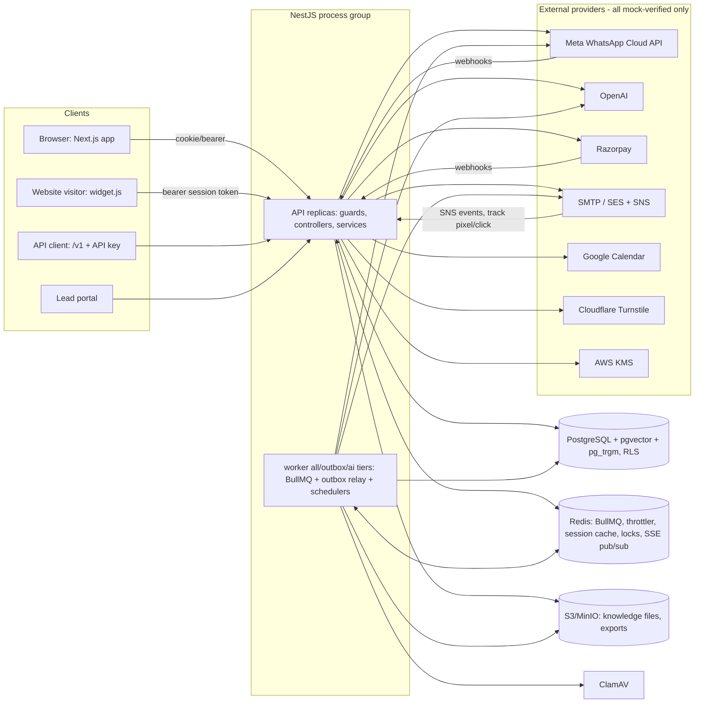

# 05 — System Architecture (as implemented)

## 1. Architectural style

**Modular monolith + background workers + shared contracts**, in a pnpm/Turborepo workspace (`pnpm-workspace.yaml`: `apps/*`, `packages/*`).

| Unit | Path | Role |
|---|---|---|
| `@leadpilot/api` | `apps/api` | NestJS 12 HTTP API (`main.ts`, `bootstrap.ts`) **and** the worker entrypoints (`worker.ts`, `worker-outbox.ts`, `worker-ai.ts`) — same code, different `WORKER_TIER` |
| `apps/worker` | `apps/worker` | 2 files; thin package wrapper, the real worker code is in `apps/api/src/ops/jobs.service.ts` |
| `@leadpilot/web` | `apps/web` | Next.js 16 App Router, React 19 client-heavy UI, CSP-nonce middleware |
| `@leadpilot/database` | `packages/database` | Prisma schema, 41 migrations, generated client, `withTenant()`, soft-delete extension, seed/bootstrap/sync scripts |
| `@leadpilot/validation` | `packages/validation` | Zod schemas shared by API, web and tests |
| `@leadpilot/shared-types` | `packages/shared-types` | Permission catalog, industry packs, terms text, email-tracking types |
| `e2e` | `e2e/` | Playwright suites (19 specs) with axe |

Dependency direction is healthy: `web → validation/shared-types`, `api → database/validation/shared-types`; packages do not import apps. [Fact: package.json workspaces + imports sampled]

## 2. Runtime topology

Production shape (`infrastructure/docker/docker-compose.prod.example.yml`, `infrastructure/ecs-fargate-reference.md`): API replicas with `WORKERS_ENABLED=false`, separate `worker`, `worker-outbox`, `worker-ai`, `web`, and a one-shot `migrate` service (`prisma migrate deploy`, permission and system-role sync, pack backfill). Databases are external managed services. The file declares itself **unverified as a whole**.

## 3. Request pipeline [Fact]

`apps/api/src/app.module.ts`:

1. Middleware (all routes): `requestIdMiddleware`, `httpMetricsMiddleware`, access log, `cookie-parser`, `csrfOriginMiddleware([WEB_ORIGIN])`.
2. Global guards, in order: `ThrottlerGuard` (Redis storage outside tests) → `AuthGuard` (access token from bearer/cookie; session validity via Redis cache then DB; optional support-session token) → `TenantGuard` (loads membership + role permissions in a tenant transaction; enforces workspace MFA policy; suspended-tenant denial) → `PlanGuard` (`@RequireFeature`) → `PermissionsGuard` (`@RequirePermissions`, all-of semantics).
3. `ZodPipe` validates bodies/queries per route; `AllExceptionsFilter` shapes errors `{code, message, requestId}`.
4. Service layer calls `DbService.tenantTx()` → `withTenant()` → `set_config('app.tenant_id', …, true)` inside a transaction so RLS applies.

Authorization is **layered**: decorators for coarse permissions, service-level checks for row-level rules (`leads.service.ts:24-33`, `tasks.service.ts:11-12`, `analytics.module.ts:27,119`). This is a strength but makes completeness hard to see (doc 08 S-05, doc 06 API-2, doc 14 TD-06).

## 4. Data flow: critical workflows

### 4.1 WhatsApp inbound → AI reply
`POST /webhooks/whatsapp/:key` (public, signature-verified) → `inbound.service.ts` (tenant resolved from channel key; idempotent on provider message id; upsert lead/conversation; write Consent on STOP or first message; message insert + `OutboxEvent` in the same tx). Two paths then run: (a) outbox relay (`OutboxRelay`, `FOR UPDATE SKIP LOCKED`, 1 s timer in the worker) → automation engine and webhooks; (b) **AI reply: `AiTrigger.fire()` in the API process (`inbound.service.ts:106`) → `AiOrchestrator.enqueue` → an in-memory per-conversation debounce timer (`orchestrator.ts:65-72`) → `turn()`** (retrieval from `KnowledgeChunk`, LLM, tool executions) → outbound `Message` + `WHATSAPP_CLIENT.sendText` → status webhooks update `Message`/`BroadcastRecipient` → SSE event via Redis `rt:<tenant>` to open inboxes.
Reliability: the outbox path is durable (good). **The AI path is not**: the debounce timers and in-flight set live in API process memory and the AI turn runs in the API tier, not a worker. A restart or deploy during the debounce window drops the pending turn, and no sweeper for unanswered inbound messages was found in `ai/`; the next inbound message recovers it (the turn recomputes pending messages from the DB, `orchestrator.ts:108`), the last one does not. Cross-instance duplicate turns are prevented by a unique 'one running per conversation' index on the run record (`:113`), which is good. External send is not in the same transaction as persistence; retry endpoint exists (`POST /conversations/:id/messages/:mid/retry`).

### 4.2 Appointment booking with calendar push
`POST /appointments` → availability + Postgres exclusion constraint (migration `appointment_service_type`, `appointments-exclusion-unit.test.ts`) → `AppointmentsService` calls `GoogleCalendarService.syncAppointment(tx, …)` **inside the open DB transaction**, `.catch(() => null)` (`appointments.service.ts:282,303`). Consequences: network latency holds a DB connection (default tx timeout 15 s, `packages/database/src/index.ts`), and sync failures are invisible and never retried.

### 4.3 Broadcast campaign
`POST /campaigns/:id/launch` → one tx: read campaign, load **all** matching leads and their consents into memory, create `BroadcastRecipient` rows (PENDING or SKIPPED_OPT_OUT), set RUNNING → enqueue `broadcast-campaigns` job (`jobId = campaign:<id>:<Date.now()>`, `concurrency: 3`) → `dispatchBatch(50)`: for each recipient **send via WhatsApp first**, then a tx to write conversation/message/recipient/campaign counters; 50 ms sleep between sends; when batch ends re-enqueue next batch. Failure semantics: a send success followed by a failed DB tx leaves the recipient PENDING → re-sent on the next batch. No claim/lease, no idempotency key on the provider call. See doc 08 S-01/S-02, doc 09.

### 4.4 Tracked email
`POST /emails/send` → suppression lookup → HTML instrumented (`instrumentHtml`: every `http(s)` link → `/track/click/<HMAC token>`, pixel `/track/open/<token>`) → `MailService.sendCustom` (nodemailer SMTP transport) → `TrackedEmail` row (`sesMessageId` and `smtpMessageId` both set to nodemailer's id) → SNS webhook (`POST /webhooks/ses`, signature verified by `sns-validator.ts` with an `sns.*.amazonaws.com` host allow-list) updates status and writes suppressions on hard bounce/complaint. Pixel and click routes are public, `@SkipThrottle`.

### 4.5 Billing
Client → `POST /billing/subscribe` → Razorpay client (mock or live by `RAZORPAY_MODE`) → webhook `POST /webhooks/razorpay` (raw-body HMAC, de-dup by event id, idempotent handlers) → `Subscription`/`Invoice`/`Payment`/`BillingEvent` → dunning/grace jobs (`billing-lifecycle.ts`).

## 5. Background processing

| Queue / loop | Defined in | Concurrency | Tier |
|---|---|---|---|
| `automation-runs` | `jobs.service.ts:105` | 5 | outbox/all |
| `webhook-deliveries` | `:110` | n/a | outbox/all |
| `maintenance` (minute scheduler, sweepers, purge, scheduled-campaign check) | `:117,:200-229` | 1 | outbox/all |
| `broadcast-campaigns` | `:97` | 3 | see note |
| `ai-knowledge-docs` | `:131` | n/a | ai |
| Outbox relay timer | `OutboxRelay` | in-process interval | outbox/all |
| Worker heartbeat + alerts | `worker-heartbeat.ts`, `alerts.service.ts` | – | all |

Tier note [Fact, `jobs.service.ts:77-100`]: the campaigns queue, runs, webhooks and maintenance queues and workers start only in the `outbox`/`all` tiers; the `ai` tier runs only `ai-knowledge-docs`. The campaigns queue has default `attempts: 3` with exponential backoff, so a job that throws after sending some recipients is **retried automatically**, which makes the non-idempotent sender (doc 08 S-02) more likely to double-send, not less.

**Hook wiring smell:** `JobsService` exposes optional mutable callbacks (`processCampaignBatch`, `checkScheduledCampaigns`, `processDoc`) that other services assign in `onModuleInit` (`campaigns.service.ts:67-77`); `AiTrigger.handler` (`ai/ai-trigger.ts`, assigned in `orchestrator.ts:55`) uses the same pattern. If the assigning module is not loaded, `if (this.processCampaignBatch)` silently skips the job (it completes successfully and the campaign stalls). Replace with explicit DI or a processor registry.

## 6. Cross-cutting concerns

| Concern | Implementation |
|---|---|
| Config | `config/env.ts`, Zod-validated; `.env.example` listing ~95 variables; `env-example.test.ts` keeps it honest |
| Secrets at rest | `crypto/secret-box.ts` envelope encryption, `KEY_PROVIDER` local or KMS; per-tenant AAD |
| Outbound HTTP | `common/safe-http.ts` SSRF-safe client (tested); Google Calendar and SNS cert fetch use raw `fetch` to fixed hosts |
| Observability | JSON logger with request/tenant/user/job context (`AsyncLocalStorage`), EMF metrics, alert rules, health snapshot (`/health`, `/health/ready`), worker heartbeat; runbooks and SLO docs |
| Realtime | SSE `/realtime/stream` with Redis pub/sub `rt:*` and in-process fallback |
| Audit | `AuditService`, partitioned `audit_logs`, platform audit separate |
| Frontend security | Nonce CSP in `apps/web/middleware.ts` + `lib/csp.ts` (tested), API-side Helmet CSP, strict CORS with a widget exception |

## 7. Architectural assessment

**Strengths**
- Right-sized: one deployable codebase, clear module folders, no premature microservices.
- Tenancy is enforced twice (guards + RLS) and `withTenant` is the single door to tenant tables.
- Outbox + idempotent handlers + sweepers handle at-least-once delivery for core flows.
- Worker tiers (`all|outbox|ai`) isolate CPU-heavy embedding from latency-sensitive outbox work without new services.

**Weaknesses**
| # | Issue | Evidence |
|---|---|---|
| A1 | `ops/` is a god module: appointments, automations, tasks, notifications, SLA, alerts, outbox, webhook dispatcher, billing lifecycle, scanners, usage (43 endpoints, 30 files) | `apps/api/src/ops/` |
| A2 | Controllers and services declared inside `*.module.ts` (e.g. `ai.module.ts`, `roles.module.ts` 307 lines, `capture.module.ts`, `channels.module.ts`, `pipeline.module.ts`) | file sizes/contents |
| A3 | Oversized services: `email-tracking.service.ts` 976, `campaigns.service.ts` 814, `leads.service.ts` 486, `appointments.service.ts` 453, `automation-engine.ts` 419 lines | `wc -l` |
| A4 | Mutable-callback wiring between `JobsService` and feature services | §5 |
| A5 | External I/O inside DB transactions (GCal push) | §4.2 |
| A6 | Per-request tenant resolution performs a DB transaction (`TenantGuard`) before the handler's own transaction → ≥2 pool checkouts per request, no membership cache | `guards.ts` |
| A7 | Single Redis for queues, throttling, locks, sessions, pub/sub: a single point of failure; no Sentinel/Cluster stance in code | env + compose |
| A8 | Hand-written web API client coexisting with generated client | doc 06 §6 |
| A10 | AI reply turns are not durable: in-process debounce timers, run in the API tier, no sweeper for unanswered messages | `ai/orchestrator.ts:36,65-72`; `ai/ai-trigger.ts` |
| A9 | I did not run a dependency-graph tool (e.g. madge); by inspection no circular module dependency was seen, but `ops` ↔ `integrations/google-calendar` (optional injection) and `campaigns` → `jobs` (callback) are loose couplings that hide runtime wiring | imports |

**Single points of failure:** Redis, the one Postgres primary (no read replica or failover stance in repo), the SMTP provider, and the single `maintenance` scheduler queue (concurrency 1 by design, protected by the distributed lock module `common/lock.service.ts`).
