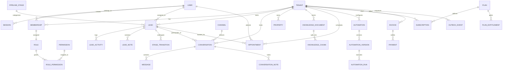

# Database Architecture & Entity-Relationship Audit: LeadPilot AI

## 1. Database Architecture & Multi-Tenancy Design

The data layer of LeadPilot AI is powered by **PostgreSQL 17** with the **pgvector** extension enabled for vector similarity search, managed through **Prisma ORM 7.10.1** with the `@prisma/adapter-pg` driver adapter.

### Dual-Role Multi-Tenant Security Model
LeadPilot implements database-level multi-tenancy using PostgreSQL **Row-Level Security (RLS)** coupled with dual connection roles:
1. **Migration Owner Role** (`DATABASE_OWNER_URL`): High-privilege role (`leadpilot_owner`) with `BYPASSRLS`. Used strictly for executing Prisma schema migrations (`prisma migrate deploy`) and system setup scripts.
2. **Application Role** (`DATABASE_URL`): Restricted application connection pool (`leadpilot_app`) with `NOBYPASSRLS`. All web and API traffic connects through this role.

### The `withTenant()` Transaction Protocol
Every tenant-scoped query is executed through `withTenant(prisma, ctx, fn)` in `packages/database/src/index.ts`:
```sql
SELECT set_config('app.tenant_id', $1, true), set_config('app.user_id', $2, true);
```
Setting the third parameter to `true` marks the configuration local to the current transaction. This prevents leakage across pooled connections when running in transaction-pooling mode (e.g., PgBouncer).

---

## 2. Comprehensive Database Entity Inventory

The schema (`packages/database/prisma/schema.prisma`) comprises **58 models** and **18 enums** organized into 7 logical clusters:

| Domain Cluster | Model Count | Key Entities | Primary Responsibilities |
|---|:---:|---|---|
| **Identity & Access** | 10 | `User`, `Membership`, `Role`, `Permission`, `RolePermission`, `Invitation`, `Session`, `EmailVerificationToken`, `PasswordResetToken`, `AuditLog` | User authentication, session revocation, RBAC permissions, and monthly-partitioned audit trails. |
| **Tenancy & Core CRM** | 12 | `Tenant`, `PipelineStage`, `LostReason`, `LeadSource`, `CustomFieldDefinition`, `Lead`, `Tag`, `LeadTag`, `LeadNote`, `LeadActivity`, `StageTransition`, `Property` | Workspaces, custom pipeline stages, lead records, deduplication, activity timelines, real estate property units. |
| **Communication** | 8 | `Channel`, `WidgetConfig`, `IntegrationCredential`, `Conversation`, `Message`, `ConversationNote`, `Consent`, `WhatsappTemplate` | WhatsApp WABA channels, website widget configs, chat threads, encrypted credentials, message delivery ticks. |
| **AI & Knowledge** | 7 | `AiAssistant`, `AiRun`, `AiToolExecution`, `KnowledgeDocument`, `KnowledgeChunk`, `ScoringRuleSet`, `LeadScore` | AI assistant prompts, execution runs, chunk embeddings (`vector(1536)`), rule-based scoring models. |
| **Operations & Automations** | 9 | `Appointment`, `AvailabilityRule`, `AvailabilityException`, `AppointmentEvent`, `Automation`, `AutomationVersion`, `AutomationRun`, `Task`, `SlaBreach` | Double-booking-safe appointments calendar, rep working hours, visual DAG workflows, step logs, follow-up tasks. |
| **SaaS & Commercial** | 8 | `Plan`, `PlanEntitlement`, `Subscription`, `BillingProfile`, `Invoice`, `Payment`, `BillingEvent`, `InvoiceCounter` | Plan definitions, feature gating flags, Razorpay recurring subscriptions, legal Indian GST tax invoices. |
| **Platform & Compliance** | 4 | `PlatformAdmin`, `PlatformAuditLog`, `OpsAlert`, `TenantDeletionRequest`, `DataExport`, `SupportAccessSession` | Super-admin console, system-wide metrics, emergency impersonation, DPDP Act data deletion pipelines. |

---

## 3. Entity-Relationship Diagram (ERD)



---

## 4. Database Schema Deep-Dive & Quality Analysis

### A. Soft Deletion Engine
- Soft deletion is implemented for three core entities: `Lead`, `Property`, and `KnowledgeDocument`.
- These tables contain a `deletedAt DateTime?` column.
- To prevent developers from accidentally writing leaky queries (`where: { status: 'ACTIVE' }` without checking `deletedAt: null`), the application wraps Prisma with a custom extension (`packages/database/src/soft-delete.ts`).
- **Extension Behavior**: Injects `where: { deletedAt: null }` into all `findMany`, `findFirst`, `count`, `aggregate`, and `groupBy` queries automatically, unless an explicit `{ withDeleted: true }` parameter is passed.

### B. Indexing Strategy & Trigram Full-Text Search
- **Trigram Search**: The `leads` table features `gin` indexes on `name gin_trgm_ops`, `email gin_trgm_ops`, and `phone gin_trgm_ops`. This allows sub-100ms partial-match searches across 100k+ records (e.g., searching "Sharma" or "+91987").
- **Composite Indexes**:
  - `leads(tenant_id, temperature, status)` for rapid hot-lead dashboard queries.
  - `conversations(tenant_id, status, mode)` for inbox queue partitioning.
  - `messages(conversation_id, created_at ASC)` for conversational thread rendering.
  - `outbox_events(status, run_at ASC)` for low-latency outbox worker claiming.

### C. Partitioning Strategy
- **Audit Logs Table**: `audit_logs` is physically partitioned by month using PostgreSQL range partitioning on the `created_at` timestamp:
  ```sql
  CREATE TABLE audit_logs (...) PARTITION BY RANGE (created_at);
  ```
  This prevents audit trails from degrading query performance over multi-year retention spans and allows old logs to be archived or dropped efficiently via partition detachment.

---

## 5. Identified Data Integrity Risks & Schema Deficiencies

| Risk Category | File / Model | Risk Description & Evidence | Impact & Recommendation |
|---|---|---|---|
| **High: Inactive Lead Assignment** | `packages/database/prisma/schema.prisma` (`Lead.assignedUserId`) | `assignedUserId` has a foreign key to `users(id)` without validating if the user's `membership` in that tenant is `ACTIVE`. | A deleted or deactivated employee can remain assigned to active leads. Implement an application-level guard and check `MembershipStatus == ACTIVE` during assignment. |
| **Medium: Missing Unique Booking Constraint** | `schema.prisma` (`Appointment`) | There is no composite database-level exclusion constraint preventing two overlapping appointments for the same `userId` and `startAt`. | Concurrency relies entirely on transaction-level locks in `AppointmentsService.book()`. Introduce a PostgreSQL `tstzrange` exclusion constraint using the `btree_gist` extension to enforce calendar integrity at the DB level. |
| **Medium: Unbounded Message Growth** | `schema.prisma` (`Message`) | The `messages` table is unpartitioned and stores raw text alongside message metadata. | At scale (100 tenants * 1,000 leads * 50 messages = 5M rows/month), this table will become a bottleneck. Plan table partitioning on `messages` by quarter. |
| **Low: Custom Field JSON Validation** | `schema.prisma` (`Lead.customFieldValues`) | Stored as a raw `Json` column on `Lead`. | Values are validated only at the application boundary via Zod. If directly inserted via SQL or scripts, schema mismatches can occur. |
| **Low: Outbox Event Retention** | `schema.prisma` (`OutboxEvent`) | Successfully completed outbox events accumulate in `outbox_events`. | A daily background cron job should prune processed events older than 7 days to maintain table compaction. |
