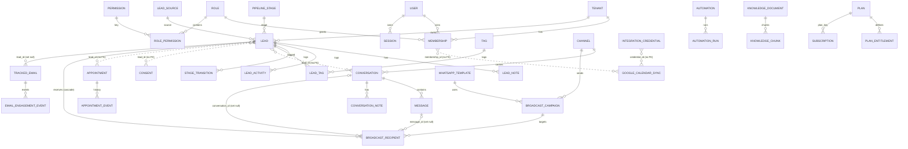

# 07 — Database Architecture

**Engine:** PostgreSQL (pgvector, pg_trgm, citext) via Prisma with `@prisma/adapter-pg`; schema `packages/database/prisma/schema.prisma` (81 models, 28 enums), 41 migrations (`packages/database/prisma/migrations`). Facts below come from the schema and migration SQL; **no live database was inspected**, so index usage, table sizes and query plans are unknown.

## 1. Access model

| Mechanism | Detail | Evidence |
|---|---|---|
| Two DB roles | Owner role runs migrations; runtime role `leadpilot_app` is non-superuser, non-owner, so RLS always applies | `20261116115000_rls/migration.sql` header; `.env.example` `DATABASE_OWNER_URL` / `DATABASE_URL` |
| Tenant context | `withTenant()` opens a transaction and sets `app.tenant_id` / `app.user_id` via `set_config(..., true)` (transaction-local, safe with pgbouncer transaction pooling); UUID-validated | `packages/database/src/index.ts` |
| Policies | `tenant_isolation` (`tenant_id = app_tenant_id()`, USING + WITH CHECK) applied by `DO $$ FOREACH` loops per phase migration; special policies for `tenants`, `memberships`, `roles`, `audit_logs` (insert/select only), platform-only tables | migrations `*_rls`, `data_lifecycle`, `public_api_webhooks`, `lead_portal` |
| Least privilege | Per-table GRANTs; append-only history tables get `SELECT, INSERT` only (`lead_activities`, `stage_transitions`, audit) | `20261116124000_crm_rls` |
| Not `FORCE`d | Table owner bypasses RLS; only migration/SECURITY DEFINER helpers use the owner role | RLS migration header |
| Soft delete | Prisma extension `softDeleteExtension` for exactly three models: `Lead`, `Property`, `KnowledgeDocument` (`SOFT_DELETE_MODELS`) | `soft-delete.ts` |
| IDs | UUID; app-generated UUIDv7 for hot tables, `gen_random_uuid()` defaults elsewhere (mixed) | schema, services |
| Test | `packages/database/test/rls-isolation.test.ts` | |

66 models carry `tenant_id`; 15 are global/platform (`Tenant`, `User`, `Permission`, `Session`, token tables, `Plan`, `PlanEntitlement`, `BillingEvent`, `InvoiceCounter`, `PlatformAdmin`, `OpsAlert`, `MfaCredential`, `MfaRecoveryCode`, `UserAlertSettings`). The three newest migrations each enable RLS and grants for their tables (verified in SQL).

## 2. Entity inventory (81 models)

| Domain | Models | Notes |
|---|---|---|
| Identity & tenancy | Tenant, User, Session, EmailVerificationToken, PasswordResetToken, Membership, Invitation, MfaCredential, MfaRecoveryCode, UserAlertSettings | `email` is `citext @unique` |
| RBAC | Permission, Role, RolePermission | system roles seeded per tenant; custom roles `isSystem=false` |
| CRM | Lead, LeadSource, PipelineStage, LostReason, Tag, LeadTag, LeadNote, LeadActivity, StageTransition, CustomFieldDefinition, Property, ApiKey | trigram GIN indexes on lead name/email/phone |
| Communication | Channel, IntegrationCredential, WidgetConfig, Conversation, Message, ConversationNote, Consent, WhatsappTemplate, WebhookEvent | `Conversation` unique `(channelId, externalThreadId)` |
| **Campaigns (new)** | BroadcastCampaign, BroadcastRecipient | recipient unique `(campaignId, leadId)` |
| **Email (new)** | TrackedEmail, EmailEngagementEvent, EmailSuppression | suppression unique `(tenantId, email)` |
| AI | AiAssistant, AiRun, AiToolExecution, KnowledgeDocument, KnowledgeChunk (vector), ScoringRuleSet, LeadScore | |
| Scheduling | AvailabilityRule, AvailabilityException, Appointment, AppointmentEvent, **GoogleCalendarSync (new)** | exclusion constraint on appointments |
| Automation & work | Automation, AutomationVersion, AutomationRun, Task, Notification, NotificationPreference, SlaBreach, EventMark | |
| Billing | Plan, PlanEntitlement, Subscription, BillingProfile, Invoice, Payment, BillingEvent, InvoiceCounter | |
| Platform | PlatformAdmin, PlatformAuditLog, OpsAlert, SupportAccessSession | |
| Platform infra | OutboxEvent, IdempotencyKey, AuditLog (monthly partitioned), WebhookEndpoint, WebhookDelivery | |
| Privacy | DataExport, TenantDeletionRequest, PortalConfig, PortalLoginCode, PortalSession | |

## 3. ER diagram (core relationships, FK-backed unless noted)

Dotted relations (`no FK`) are logical links that the schema does **not** enforce (see §4).

## 4. Analysis

### 4.1 Referential integrity — **the main structural weakness**
- Only **36 `FOREIGN KEY` constraints exist across all migrations** for 81 models. Only 6 migrations lines reference `tenant_id → tenants`: `tenant_id` on most tables (e.g. `conversations`, `messages`, `appointments`, `tasks`, `tracked_emails`, `broadcast_campaigns`) is a plain UUID protected by RLS but **not** by a foreign key.
- Missing FKs I verified: `GoogleCalendarSync.membershipId` and `.credentialId` (`20261123160000_google_calendar_sync` has no `REFERENCES`); `leads.assigned_membership_id`; `conversations.lead_id`; `appointments.lead_id`; `consents.lead_id` (not in the FK list extracted from all migrations).
- Consequences: (a) orphaned rows after hard deletes or purges, cascades must be hand-written (`lifecycle/lifecycle-jobs.ts` purge, `privacy.module.ts` erase); (b) typos or races can insert a `lead_id` that never existed; (c) no `ON DELETE` semantics at DB level. Tenant deletion itself is **robust**: `purge_tenant()` (`20261117020000_data_lifecycle`) discovers tables dynamically from `information_schema` (every table with a `tenant_id`), retries on FK violations for up to 8 passes and raises if any table remains, so new tables are covered automatically. That function is likely why FKs were kept sparse; it compensates, it does not replace integrity. No ADR explains this choice (`docs/decisions/` searched for "foreign key"/"referential": nothing).
- **[Rec]** add FKs in a staged way (§6) starting with `tenant_id → tenants(id) ON DELETE CASCADE` where purge ordering permits, `lead_id` links, and membership links; use `NOT VALID` then `VALIDATE CONSTRAINT` so no long locks or failures on existing data.

### 4.2 Constraints done well [Fact]
- Appointment overlap prevented by exclusion constraint (`EXCLUDE USING gist` in `20261116200000_appointments_automation_rls`; `appointments-exclusion-unit.test.ts`).
- Idempotency: `unique(campaignId, leadId)`, `unique(tenantId, email)` for suppressions, `unique(tenantId, membershipId)` for calendar sync, `Conversation(channelId, externalThreadId)`.
- Token/hash uniqueness for sessions and tokens; `citext` emails.
- Append-only grants for history tables.

### 4.3 Indexing
- 115 `@@index`/`@@unique` declarations plus trigram GIN indexes for fuzzy lead search and a partial index approach on soft-deleted leads.
- Reasonable composite indexes on new tables: `tracked_emails(tenant_id, created_at DESC)`, `(tenant_id, recipient)`, `(tenant_id, lead_id)`; `broadcast_recipients(tenant_id, campaign_id, status)`.
- Gaps / questions (Inference, validate with `EXPLAIN` on production-like data):
  - `tracked_emails(ses_message_id)` is indexed **without** `tenant_id` and the SNS webhook matches `OR smtpMessageId` as well, with no index on `smtp_message_id` → seq scan risk on the OR branch.
  - `email_engagement_events` has no index for time-range queries across a tenant (`stats` aggregates).
  - `consents`: the index `(tenant_id, lead_id, channel, created_at DESC)` exists (`schema.prisma:714`), so the latest-consent lookup is indexed; the remaining concern is campaign launch passing a very large `IN (leadIds)` list and loading all rows into memory.
  - `broadcast_recipients` polling `status = PENDING` is covered by the status index; fine.

### 4.4 Data lifecycle
- Audit log partitioned monthly (`20261119120000_audit_log_partitioning`); retention policy and workspace export/deletion tables exist (`DataExport`, `TenantDeletionRequest`).
- `EmailEngagementEvent` and `Message` have no retention policy visible; both are append-heavy (pixel/click hits; status events). Unbounded growth. [Inference]
- **DPDP lead erasure misses email data [Fact].** `erase_lead()` is a hard-coded SQL function last defined in `20261116230000_privacy_erasure` and not updated since; it does not mention `tracked_emails` or `email_engagement_events`. `tracked_emails.lead_id` is `ON DELETE SET NULL`, so after erasing a lead the recipient address, subject/metadata and every open/click event (with IP and user-agent) **remain**, merely detached from the lead (doc 08 S-20). `broadcast_recipients` is `ON DELETE CASCADE` from leads, so campaign rows (including the phone number) are removed. Workspace export is guarded by a test that fails when a tenant table is not classified (`ops/export-tables.ts` header); I did not check that the new tables were classified.

### 4.5 Redundant / smelly fields
| Where | Observation |
|---|---|
| `TrackedEmail.sesMessageId` and `smtpMessageId` | Both populated with the same value (`email-tracking.service.ts:227-228`). One of them is redundant; worse, the id is nodemailer's, not SES's (doc 08 S-06) |
| `BroadcastCampaign.templateName/templateLanguage` | Denormalised copies of the template row; defensible as a snapshot, but also keep `templateId` FK `RESTRICT` (prevents deleting templates used by campaigns, may surprise users) |
| `Lead.score`, `temperature`, `LeadScore` | Cached score on lead plus history table; ensure single writer (AI module) |
| `GoogleCalendarSync.syncToken`, `channelId` | Columns for incremental sync/push channels are never read by code (only free/busy + push) |
| `GoogleCalendarSync.status String` | free-text status instead of an enum (others use enums) |
| Many `Json` columns (`segment`, `templateParams`, `trigger`, `conditions`, `settings`) | Flexible but unvalidated at DB level; Zod validates at the edge only |

### 4.6 Transactions and concurrency
- `withTenant` default timeout 15 s, `maxWait` 5 s. Campaign launch builds all recipients in one transaction; a 100k-lead segment risks timeout. External HTTP calls inside transactions (Google Calendar) hold connections.
- Campaign counters are updated with `increment` per recipient inside a per-recipient transaction: contended hot row `broadcast_campaigns`, plus `lead.update` and `conversation` upserts.
- Connection pool: single `PrismaPg` pool per process with default sizing; each request opens ≥2 transactions (TenantGuard + handler). No explicit pool settings in code. [Inference: pool exhaustion under load; measure]

### 4.7 Multi-tenant isolation assessment
Strong: policy per tenant table, separate runtime role, tests. Residual risks:
1. **Completeness is already tested.** `packages/database/test/rls-isolation.test.ts` asserts that the runtime role is not superuser/BYPASSRLS and owns nothing; that *every table with a `tenant_id` column has RLS enabled and at least one policy* (L74); that it sees only its own rows on every tenant table, **nothing without tenant context** (L100), cannot read, insert, update, delete or move rows across tenants, and that a forged tenant context exposes only that tenant. New tables are covered automatically. Not tested: that each policy has both `USING` and `WITH CHECK`, and sweeps that need cross-tenant reads (see 2).
2. **Likely functional bug — scheduled campaigns never launch.** Every other cross-tenant sweep goes through `SECURITY DEFINER` functions (`claim_outbox_batch`, `list_active_tenant_ids()` in `scanners.service.ts:29`, `find_api_key_by_hash`). `CampaignsService.checkScheduledCampaigns` instead calls `this.db.prisma.broadcastCampaign.findMany({ where: { status: 'SCHEDULED', ... } })` with **no tenant context** on the runtime role (`DbModule` builds the client from `DATABASE_URL`, i.e. `leadpilot_app`). The `broadcast_campaigns` policy is `tenant_id = app_tenant_id()`; with no `app.tenant_id` set that evaluates to NULL and the query returns **zero rows** (the repo's own isolation test asserts exactly this behaviour: "sees nothing without tenant context"). `campaigns-unit.test.ts` contains no scheduled-sweep case. [Inference, high confidence; not executed. Confirm with a one-test integration check on an RLS-enforced connection.] **[Rec]** add a `list_due_campaigns()` SECURITY DEFINER function modelled on `list_active_tenant_ids()`.

## 5. Schema gaps worth adding
| Gap | Why |
|---|---|
| `consents` as a proper ledger (source, proof, text version, timestamp, channel, purpose) | Marketing opt-in evidence (doc 08 S-01) |
| `email_unsubscribes` or reuse suppression with `reason=UNSUBSCRIBE` and a public unsubscribe token | CAN-SPAM/DPDP expectations |
| `campaign_batches`/lease columns (`claimed_at`, `claimed_by`, `attempt`) on `broadcast_recipients` | Safe concurrent dispatch |
| `usage_counters` (tenant, metric, period) | Meter messages/emails for plans and billing |
| `audit_logs` hash chain or WORM export | Tamper evidence for enterprise buyers |
| Enum for `GoogleCalendarSync.status` | Consistency |

## 6. Recommended migration approach (backward compatible)
1. **Observe:** run orphan-detection queries per missing FK in a staging copy; record counts.
2. **Add** FK `NOT VALID` (no table rewrite, brief lock), deploy, then `VALIDATE CONSTRAINT` in a separate migration. Choose `ON DELETE` per relation (`CASCADE` for tenant-owned children, `SET NULL` for optional links, `RESTRICT` for reference data).
3. Keep application purge logic until constraints are validated, then simplify it.
4. Index additions with `CREATE INDEX CONCURRENTLY` (Prisma needs a hand-edited migration for this); never in a transaction.
5. Consent ledger: add table, backfill from `consents` rows (`source='legacy'`), dual-write, then switch campaign eligibility to the ledger. Old column readers keep working.
No destructive change (drops/renames) is recommended in this audit.
