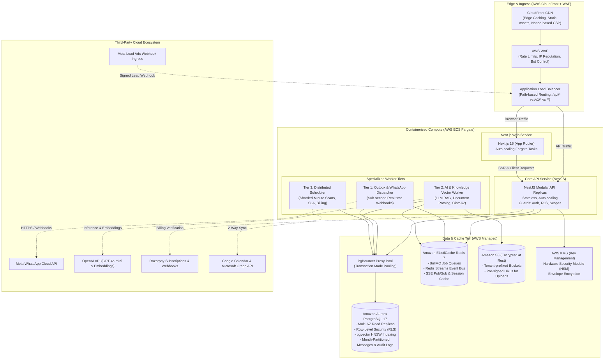

# Ideal Target-State Architecture: LeadPilot AI

## 1. Architectural Philosophy: Pragmatic Modernization

The target architecture avoids unnecessary distributed microservices complexity, event sourcing, or premature multi-region clustering. The existing **Modular Monolith** pattern is sound, performant, and maintainable.

The modernization strategy focuses on three pragmatic evolutions:
1. **Worker Process Specialization**: Decoupling the background worker runtime into dedicated execution tiers (I/O Outbox Worker vs. Heavy AI/Vector Worker vs. Cron Scheduler).
2. **Event Stream Modernization**: Evolving the polling-based PostgreSQL outbox table into a Redis Streams / BullMQ event bus for high-throughput, low-latency asynchronous processing.
3. **External Integration Hub**: Introducing standardized adapter interfaces for calendar synchronization (Google/Outlook), ad platforms (Meta/Google), and portal lead ingestion.

---

## 2. Target Architecture Diagram

---

## 3. Key Target Architectural Enhancements

### A. Worker Process Specialization
Instead of running all background tasks in a single monolith worker process (`apps/worker`), the container image should be deployed into three independently scalable ECS task definitions:
1. **Outbox & Real-Time Worker**: High-priority, CPU-light. Consumes the outbox and delivers outbound WhatsApp messages and webhooks. Auto-scales based on queue depth to guarantee sub-second delivery.
2. **AI & Document Processor**: Memory-intensive. Executes LLM RAG pipelines, chunks uploaded documents, and performs ClamAV virus scanning. Isolated so heavy PDF parsing cannot stall real-time messaging.
3. **Partitioned Cron Scheduler**: Executes scheduled sweeps (SLA checks, inactive lead re-engagement, appointment reminders). Sharded using database partition modulus (`WHERE abs(hashtext(tenant_id::text)) % N = CURRENT_WORKER`) to support horizontal scaling across thousands of tenants.

### B. Two-Way External Calendar Synchronization
Introduce a dedicated `CalendarSyncModule`:
- **Architecture**: Maintains an OAuth2 connection to Google Calendar and Microsoft Graph API per sales agent.
- **Conflict Prevention**: Prior to offering available appointment slots, the slot-finding algorithm evaluates both internal LeadPilot bookings and external Google Calendar busy blocks.
- **Webhook Push Notifications**: Subscribes to Google Calendar push notifications (`channel_id`), automatically updating rep availability when events are added or modified on personal devices.

### C. Meta Lead Ads Webhook Adapter
- **Architecture**: A dedicated controller `/webhooks/meta/leads` receiving real-time lead gen events from Facebook/Instagram ads.
- **Decryption & Mapping**: Fetches the lead payload using the Meta Graph API, extracts ad campaign metadata, parses custom form fields, and injects the prospect directly into the Lead CRM, instantly triggering the AI qualification workflow.

### D. Zero-Downtime Database Migration Framework
To ensure continuous availability during schema evolutions:
1. **Expand and Contract Pattern**: All schema migrations must be backward-compatible. Add nullable columns first; deploy code writing to both; backfill data; remove old columns in subsequent releases.
2. **Transaction-Safe Indexes**: All PostgreSQL index creations must utilize `CREATE INDEX CONCURRENTLY` to prevent locking high-traffic tables like `leads` and `messages`.

### E. Advanced Observability & Telemetry
- **OpenTelemetry Instrumentation**: Instrument NestJS controllers and worker jobs with OpenTelemetry spans exported to AWS CloudWatch / Datadog.
- **Trace Propagation**: Propagate `x-request-id` from the Next.js client through the API HTTP layer, into the PostgreSQL outbox event payload, and across BullMQ worker jobs, providing end-to-end distributed tracing for every customer interaction.
