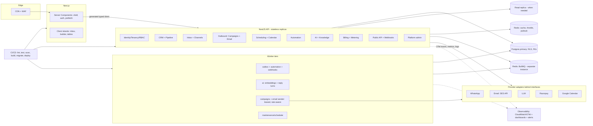

# 12 — Target Architecture

**Principle:** evolve the existing modular monolith. The evidence (doc 05) shows a sound style; the problems are boundary discipline, a few unsafe flows, and missing delivery/ops infrastructure, not the shape of the system. **No microservices, no event sourcing, no GraphQL, no separate search cluster are recommended.** Each addition below names the trigger that would justify it.

## 1. Target diagram

## 2. Module boundaries and data ownership

Make the existing folder structure *enforceable*: one Nest module per bounded context, owning its tables; cross-module access only through exported services or events; enforce with an import-boundary lint rule (e.g. `eslint-plugin-boundaries` or `dependency-cruiser` in CI).

| Module (target) | Owns tables | Exposes | Split from today's |
|---|---|---|---|
| `identity` | User, Session, tokens, MfaCredential, MfaRecoveryCode | AuthService, MFA | `auth/`, `mfa/` |
| `tenancy-rbac` | Tenant, Membership, Invitation, Role, RolePermission, Permission | actor/permission resolver (cached) | `tenants/`, `team/`, `roles/` |
| `crm` | Lead*, Tag, LeadSource, PipelineStage, LostReason, Property, CustomFieldDefinition, Consent→(moves to `consent`) | LeadsService (read model) | `leads/`, `pipeline/`, `properties/` |
| `consent` (new) | ConsentLedger | `isEligible(lead, channel, purpose)` | new; used by inbox, campaigns, email |
| `channels` | Channel, IntegrationCredential, WidgetConfig, WhatsappTemplate | provider adapters | `channels/`, `whatsapp/` |
| `inbox` | Conversation, Message, ConversationNote | ConversationsService | `conversations/` |
| `outbound` | BroadcastCampaign, BroadcastRecipient, TrackedEmail, EmailEngagementEvent, EmailSuppression | CampaignsService, EmailService | `campaigns/`, `email-tracking/` (split into `campaigns`, `email-send`, `email-events`) |
| `scheduling` | Availability*, Appointment*, GoogleCalendarSync | AppointmentsService | from `ops/` + `integrations/google-calendar/` |
| `automation` | Automation*, Task, Notification*, SlaBreach, EventMark | engine, task service | from `ops/` |
| `ai` | AiAssistant, AiRun, AiToolExecution, Knowledge*, ScoringRuleSet, LeadScore | orchestrator | `ai/` |
| `billing` | Plan*, Subscription, BillingProfile, Invoice, Payment, BillingEvent, InvoiceCounter, UsageCounter (new) | entitlements, metering API | `billing/`, `ops/usage.module.ts` |
| `portal` | PortalConfig, PortalLoginCode, PortalSession | lead self-service API | `portal/` |
| `platform` | PlatformAdmin, PlatformAuditLog, OpsAlert, SupportAccessSession | admin API | `platform/`, `support/` |
| `kernel` | AuditLog, OutboxEvent, IdempotencyKey, WebhookEndpoint/Delivery, DataExport, TenantDeletionRequest | outbox, audit, idempotency, webhooks | `audit/`, `ops/outbox*`, `webhooks/`, `lifecycle/` |

Rules: (1) a module may write only its own tables; (2) foreign reads go through exported query services; (3) cross-module side effects use the outbox (already implemented) rather than callbacks; (4) each module declares its permissions in one place.

## 3. Frontend architecture
- Keep Next.js App Router, React 19, TanStack Query, Tailwind 4, Radix. Move shell, auth gate and first-page data to **Server Components** with query prefetch/hydration; keep interactive surfaces (inbox, builder, tables) as client islands. Today 50/51 pages are client components.
- **One API client:** choose the generated Orval client (spec already emitted by `pnpm codegen:api`) and migrate the 65 hand-written consumers module by module (opportunistic: whenever a page is touched). Wrap generated hooks per feature (`features/<module>/hooks.ts`), keep Zod schemas for forms. If the team prefers hand-written clients, delete Orval; do not keep both.
- Split pages > 400 lines into feature folders (`features/tasks/{table,drawer,filters}`); enforce a size lint warning.
- Add component-level tests (Testing Library) for forms with permission variations; keep Playwright for journeys.
- Remove build-phase scaffolding (`CURRENT_PHASE`, "Soon") and gate or delete `/design/*`.

## 4. Backend/API architecture
- Permissions declared at class level per controller with explicit `@Public()`/`@NoTenant()` exceptions; keep the matrix test and extend it to assert that "own-scoped" permissions never guard tenant-wide queries (tag such handlers `@TenantWide()` and require `*:all`).
- Introduce `Idempotency-Key` support for internal mutating endpoints that cause external side effects (`messages`, `emails/send`, `campaigns/:id/launch`), reusing the `IdempotencyKey` model/interceptor from `/v1`.
- Uniform list contract: `{ items, nextCursor }`, `limit` cap, documented sort/filters via shared Zod helpers.
- OpenAPI: publish only the public `/v1` spec externally; gate `/docs`.
- Replace the mutable callbacks (`JobsService.processCampaignBatch` / `checkScheduledCampaigns` / `processDoc`, and `AiTrigger.handler`) with a **processor registry** (`@Processor('queue')` providers discovered at boot; boot fails if a queue has no processor).
- Provider adapters: extend the existing `WhatsAppClient` mock/live pattern to `EmailProvider` (SES API), `CalendarProvider`, `LlmProvider`, `PaymentProvider`; every adapter has a contract-test fixture suite recorded from real sandboxes.

## 5. Data architecture
Staged, backward-compatible (doc 07 §6): FKs (`NOT VALID` → `VALIDATE`), `ConsentLedger`, `UsageCounter`, lease columns on `broadcast_recipients`, concurrent index builds, monthly partitions for `messages`, `lead_activities`, `email_engagement_events` when approaching ~50M rows, `statement_timeout` for the app role, PgBouncer (transaction mode; already compatible thanks to `set_config(..., true)`), read replica for reports **only when** report latency or primary CPU justifies it. Sweeps use `SECURITY DEFINER` list functions (extend the pattern to campaigns).

## 6. Event-driven processing (where justified)
Keep the **transactional outbox + BullMQ**. Add: `appointment.calendar_sync`, `campaign.dispatch`, `email.send`, `consent.changed` events handled by workers with retry/backoff and dead-letter visibility. Move **AI reply turns** off in-memory debounce timers in the API process (TD-32) onto a delayed queue job per conversation, plus a sweeper that re-queues inbound messages left unanswered after N minutes; the existing unique running-turn index stays as the cross-instance lock. No Kafka/SNS fan-out until multiple independent consumers or cross-region delivery exist.

## 7. Caching
Redis: membership + permission set per `(user, tenant)` (TTL 60 s, bust on role/member change); plan entitlements per tenant; pipeline stages per tenant. Do not cache lead lists. Keep the session cache.

## 8. Search
`pg_trgm` GIN (present) measured well at 100k leads in one tenant (`docs/performance.md`: search p95 ≈ 200 ms); 1M leads is untested, so re-measure before relying on it. Add OpenSearch only when full-text across messages/notes with relevance ranking becomes a requirement.

## 9. Multi-tenancy
Retain pooled model + RLS. Add: FKs, per-tenant queue fairness (token-bucket per tenant for campaigns/AI), per-tenant quotas. Offer a siloed-database option only when an enterprise contract requires it; the code path is already `tenantId`-scoped, so a router at `DbService` is feasible.

## 10. Security architecture
- Consent gating in a single service; email scopes (`email:read:own|all`, `email:suppress:manage`).
- OAuth: server-stored state + PKCE for Google and Meta flows.
- Privacy: make `erase_lead()` table-driven (a registry of tables holding lead data, checked by a test that fails when a table with `lead_id` or recipient PII is unregistered) so new modules such as tracked email are erased automatically (S-20). `purge_tenant()` already discovers tables dynamically.
- Integrations: Google token refresh with expiry check, credential reads inside a tenant transaction, and a visible connection status (S-19).
- Secrets: require `TRACKING_SECRET`; rotate via KMS data keys; add key-rotation runbook.
- Edge: WAF/rate rules in front of public routes (widget, track, webhooks); allow-list Meta/SNS source ranges where feasible.
- Supply chain: Dependabot/Renovate, `pnpm audit` gate, CodeQL, gitleaks, container scan, SBOM, signed images.
- Enterprise track (when demanded): SAML/OIDC SSO, SCIM, audit export/hash chain, IP allow-list.

## 11. Observability
Keep JSON logs + EMF. Add OpenTelemetry tracing (HTTP → DB → queue → provider) with `requestId`/`tenantId` correlation; deploy dashboards for the SLOs in `docs/slos-and-alerts.md`; synthetic checks for WhatsApp webhook ACK, login, and campaign dispatch lag; queue depth/age alerts per queue.

## 12. Infrastructure and CI/CD
- IaC (Terraform or CDK) for the ECS Fargate reference (`infrastructure/ecs-fargate-reference.md`): API, web, four worker tiers, RDS Postgres (Multi-AZ, PITR), ElastiCache (two instances: cache/throttle vs queues), S3, KMS, SES, CloudWatch, WAF.
- Pipeline: PR → lint/typecheck/test/E2E/scan → build images → deploy staging (migration job first, smoke) → manual approval → production blue/green with automatic rollback on health check; DB migrations expand/contract only.
- Environments: dev (docker compose), staging (provider sandboxes: WhatsApp test number, Razorpay test, SES sandbox), prod.

## 13. Technology choices
| Concern | Keep | Add / change | Reason |
|---|---|---|---|
| Language/runtime | TypeScript 6, Node ≥ 22 | pin LTS-equivalents; consider holding Next/React/Nest majors until CI is green | Young majors raise defect exposure |
| API | NestJS, Zod | Idempotency middleware, processor registry | Fix real defects |
| DB | Postgres + RLS + pgvector | FKs, PgBouncer, partitions | Integrity, scale |
| Queue | BullMQ | separate Redis for queues; per-tenant rate limiting | Isolation |
| Email | SMTP (nodemailer) | SES API sender | Correct message ids, tags, configuration sets |
| Web data | TanStack Query | generated client only, RSC prefetch | One contract |
| Observability | JSON logs, EMF | OpenTelemetry + dashboards | Traceability |
| Infra | Docker, ECS reference | Terraform/CDK, CD | Reproducible deploys |
| Testing | vitest, Playwright | coverage ratchet, contract fixtures, app-role sweep test | Doc 10 |

## 14. Scalability strategy (triggers)
| Stage | Trigger | Action |
|---|---|---|
| Now | < 50 tenants | Fix the High and Medium findings in doc 08 (S-01–S-10, S-18–S-20), verify live, deploy |
| Next | API p95 > 300 ms or DB CPU > 60 % | Permission cache, PgBouncer, read replica for reports |
| Growth | Campaign > 50k recipients or queue age > 5 min | Dedicated `campaigns` worker tier, concurrent leased sender, Meta tier-aware throttle |
| Scale | > 1,000 active tenants | Shard minute scanner by tenant hash; per-tenant fairness; partition large tables |
| Enterprise | Signed contract requires | SSO/SCIM, residency (regional stacks), dedicated DB option |
