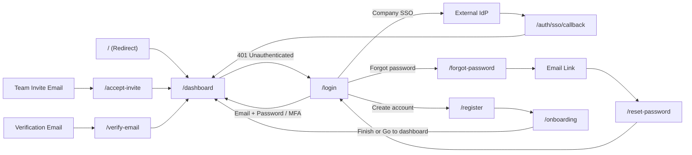
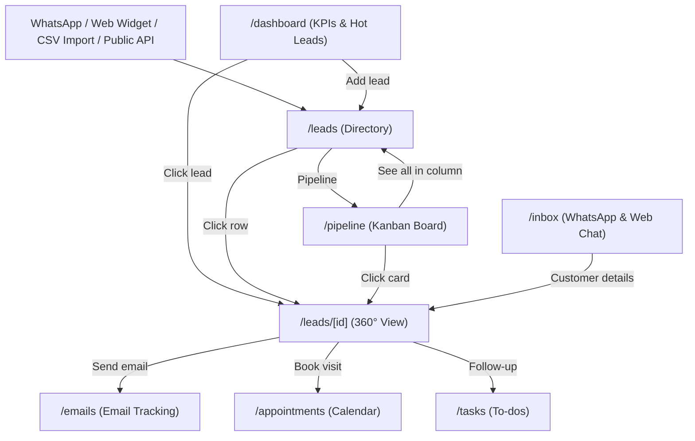
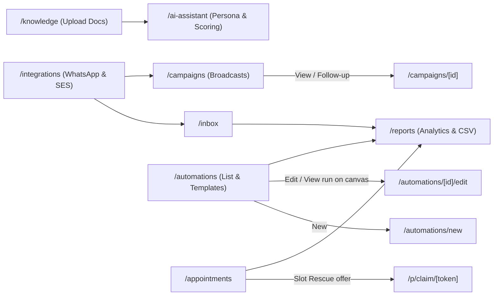
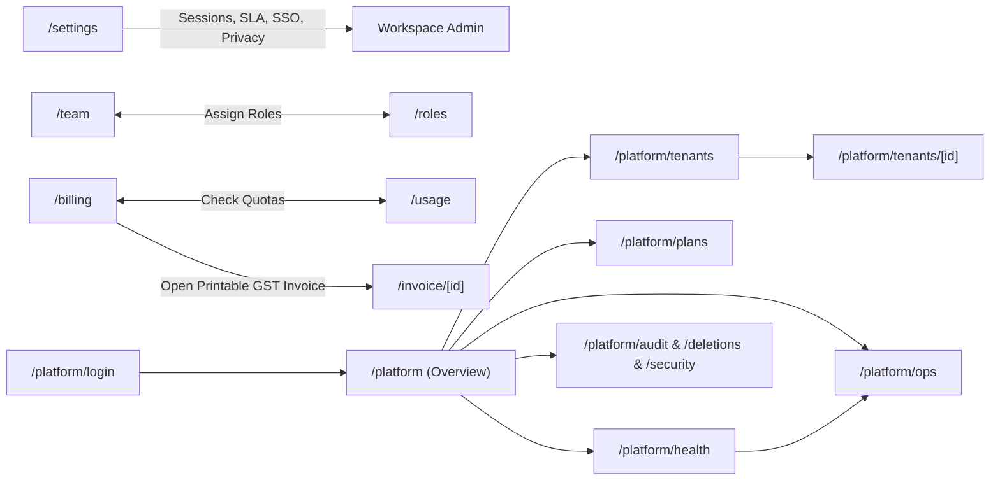

# AI LeadPilot — Screen-by-Screen Documentation

This guide explains **every screen** in the AI LeadPilot web application (`apps/web/app`): what it does, how a user flows through it, and where each action or link takes you next.

- **Per-Screen Inventory (55 Routes)**: [Screen Inventory](inventory.md) (individual documents in `docs/screens/pages/`)

## Documentation Modules

| Guide | Scope | Screens Covered |
|---|---|---|
| [01 — Auth, Public & Onboarding](01-auth-and-onboarding.md) | Sign-in, registration, SSO, invites, workspace setup, public/invoice/portal pages | `/`, `/login`, `/register`, `/auth/sso/callback`, `/verify-email`, `/forgot-password`, `/reset-password`, `/accept-invite`, `/onboarding`, `/p/[key]`, `/p/claim/[token]`, `/data-deletion`, `/invoice/[id]` |
| [02 — CRM & Messaging](02-crm-and-messaging.md) | Daily sales operations, lead management, pipeline, chat, email, broadcasts | `/dashboard`, `/leads`, `/leads/[id]`, `/pipeline`, `/inbox`, `/emails`, `/campaigns`, `/campaigns/[id]`, `/properties` |
| [03 — AI, Scheduling & Automation](03-ai-and-automation.md) | AI persona, knowledge base, appointments, tasks, visual workflows, reports | `/ai-assistant`, `/knowledge`, `/appointments`, `/tasks`, `/automations`, `/automations/new`, `/automations/[id]/edit`, `/reports` |
| [04 — Workspace Admin & Settings](04-workspace-admin.md) | Team, RBAC, channels, developer APIs, billing, usage, audit, security | `/team`, `/roles`, `/integrations`, `/api-keys`, `/webhooks`, `/billing`, `/usage`, `/audit`, `/security`, `/settings` |
| [05 — Platform Staff Console](05-platform-console.md) | Internal vendor administration, tenant lifecycle, ops health, non-product routes | `/platform/login`, `/platform`, `/platform/tenants`, `/platform/tenants/[id]`, `/platform/plans`, `/platform/ops`, `/platform/health`, `/platform/audit`, `/platform/deletions`, `/platform/security` |

---

## End-to-End Application Flows

### 1. Authentication & Onboarding Flow

### 2. Core Lead-to-Close CRM Flow

### 3. AI, Automation & Outbound Flow

### 4. Workspace Administration & Platform Console Flow

---

## Quick Screen Reference

- **Navigation Guard**: All `(app)` routes check `/auth/me`. If unauthenticated (`401`), they redirect to `/login?next=<current_path>`.
- **Industry Terminology**: Labels such as *Leads* (e.g., *Enquiries*, *Customers*) and *Properties* (shown only when enabled by the workspace's industry pack) adapt dynamically via `apps/web/lib/pack.ts` and `apps/web/lib/nav.ts`.
- **Role-Based Visibility**: Sidebar items and action buttons are gated by permissions (such as `lead:read:all`, `automation:manage`, `billing:manage`) and enforced server-side.
- **Interactive Help Tours**: Every `(app)` workspace screen includes a contextual step-by-step help tour (`apps/web/lib/tours/`) launched via the header `?` button (`HelpTourButton`) or `⌘K` (*Start page help tour*). Tours adapt to `useTerms()` and skip hidden/unmounted targets.
