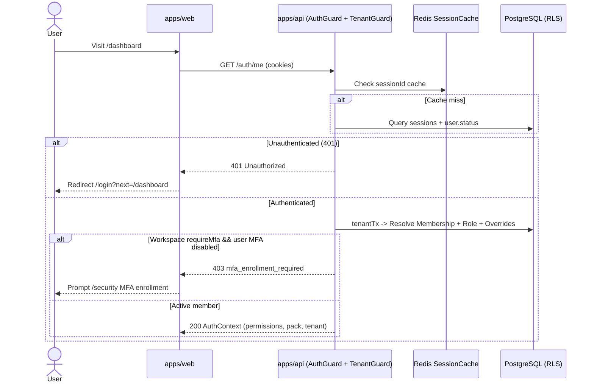
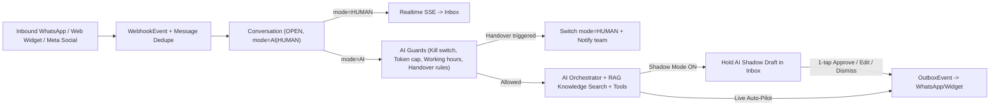

# Core Business & Technical Workflows

*Last analyzed: 2026-11-27*

## 1. Authentication, MFA & Workspace Resolution

---

## 2. Lead Capture, Deduplication & Assignment

1. **Ingress**: Leads enter via UI (`POST /leads`), CSV import (`POST /leads/import` → BullMQ `lead-imports`), Web Widget, WhatsApp inbound, Meta Lead Ads, Portal Email webhook (`/webhooks/portal-email/:key`), Google Sheets sync, or Public API (`POST /v1/leads` / `POST /public/leads`).
2. **Normalization & Deduplication**: Phone numbers and emails are normalized into `phoneNorm` and `emailNorm` (`apps/api/src/common/phone.ts`). Duplicate records can be merged via `POST /leads/:id/merge` (re-parenting notes, activities, and attachments).
3. **Assignment**: If unassigned, `round-robin.ts` assigns an eligible active team member based on workspace assignment settings.
4. **Scoring**: `ScoringService` evaluates `ScoringRuleSet` criteria to compute a numeric `score` (0–100) and `temperature` (`HOT`, `WARM`, `COLD`), unless `scoreOverridden` is `true`.

---

## 3. Omnichannel Messaging & AI Shadow-to-Live Auto-Pilot

---

## 4. Appointments & Slot Rescue

1. **Availability**: `availability.ts` computes open time slots from `AvailabilityRule` (member-specific or workspace default), minus `AvailabilityException`s, existing `Appointment`s, and `GoogleCalendarSync` busy blocks.
2. **Double-Booking Prevention**: PostgreSQL SQL exclusion constraints on `appointments` guarantee no overlapping active bookings per member.
3. **Slot Rescue**: When an appointment is cancelled and Slot Rescue is enabled, `SlotRescueService` creates a `SlotRescueOffer` with an unguessable `claimToken` and notifies top `HOT`/`WARM` leads via WhatsApp with `/p/claim/[token]?l=<leadId>`. The first lead to claim books the slot atomically; subsequent claimants receive `409 Conflict`.

---

## 5. Event-Driven Automation Engine

1. **Emit**: Domain mutations write an `OutboxEvent` row inside the same DB transaction (`OutboxService`).
2. **Relay**: `OutboxRelay` polls `outbox_events` every 1 second and enqueues `AutomationRun` jobs onto BullMQ `automation-runs` (deduplicated by `(automationId, eventId)` and respecting `cooldownMinutes`).
3. **Execute**: `AutomationEngine` + `GraphExecutor` run the pinned `AutomationVersion` graph (triggers → condition branches → wait nodes → actions like send WhatsApp template, create task, assign lead, notify team). `WAITING` runs park with `resumeAt` and are resumed by `ScannersService`.

---

## 6. WhatsApp Broadcast Campaigns

1. **Creation**: Select a `WHATSAPP` channel, an approved `WhatsappTemplate`, template parameters, and a lead segment (`POST /campaigns`).
2. **Consent & Opt-Out Gate**: Before sending, `CampaignsService` checks the append-only `Consent` ledger. Leads without opt-in or with `OPTED_OUT` are recorded as `SKIPPED_NO_CONSENT` / `SKIPPED_OPT_OUT`.
3. **Dispatch**: `broadcast-campaigns` BullMQ worker claims `PENDING` recipients (`claimedAt` lease) and dispatches messages. Failed recipients can be retried, and cohort follow-up campaigns (e.g., `READ_NO_REPLY`) can be chained via `parentCampaignId`.

---

## 7. Billing, GST Invoicing & Plan Enforcement

- Subscriptions are managed via `BillingService` + Razorpay (`RAZORPAY_MODE=mock|live`).
- `InvoiceCounter` generates gap-free per-financial-year GST invoice numbers (`SAC 998314` default).
- Intra-state (seller state code == buyer state code) splits GST into `CGST + SGST`; inter-state charges `IGST`.
- `PlanGuard` enforces read-only mode (`402`) on `EXPIRED` subscriptions and (`403`) on workspaces with a pending deletion request.
